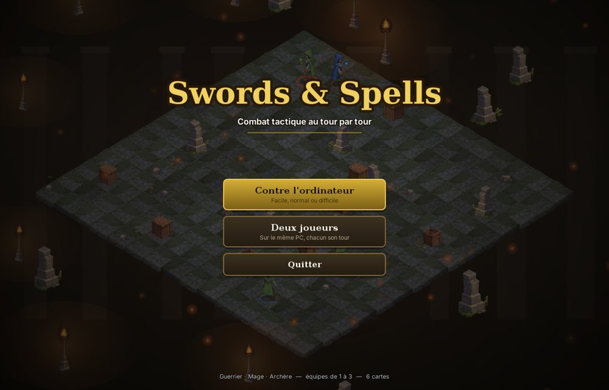
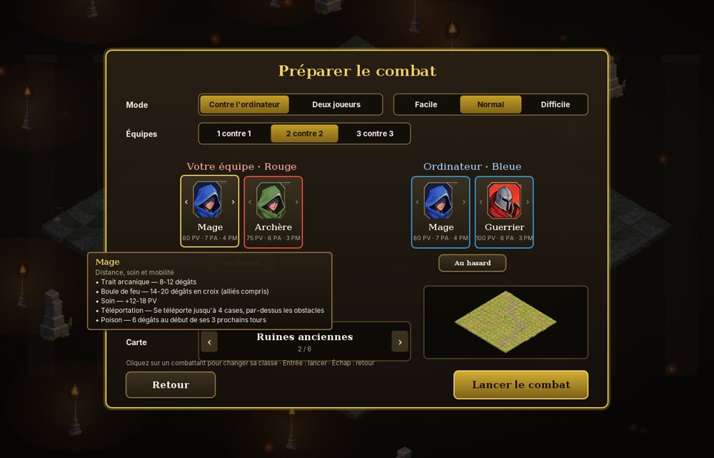
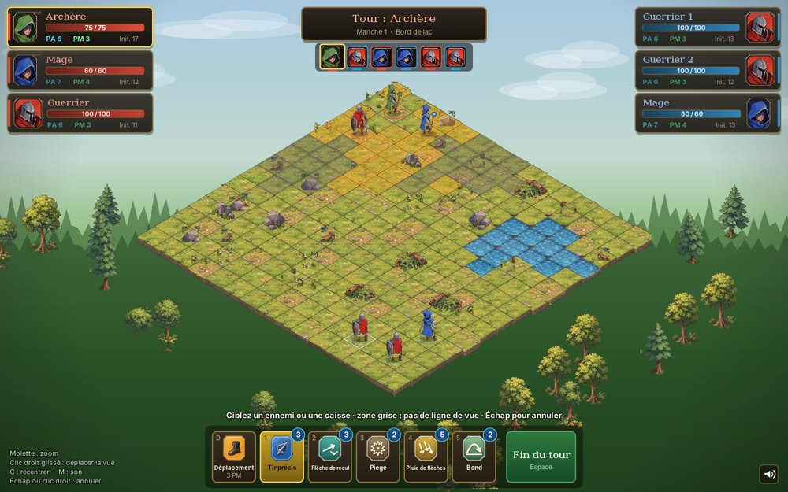
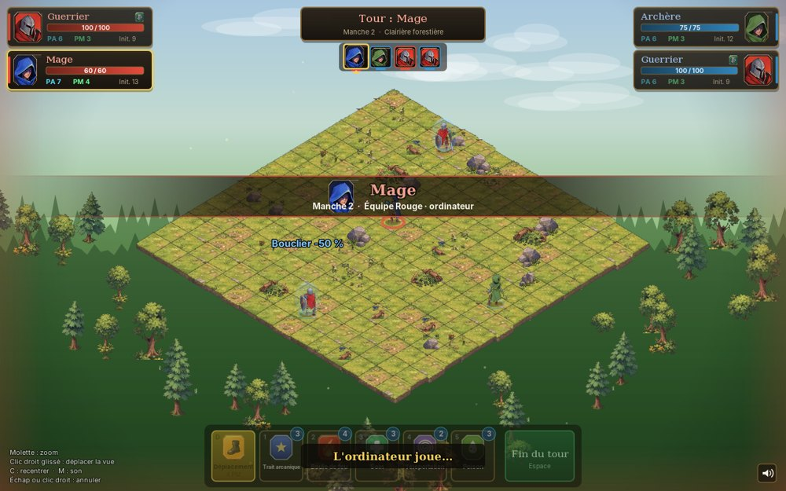
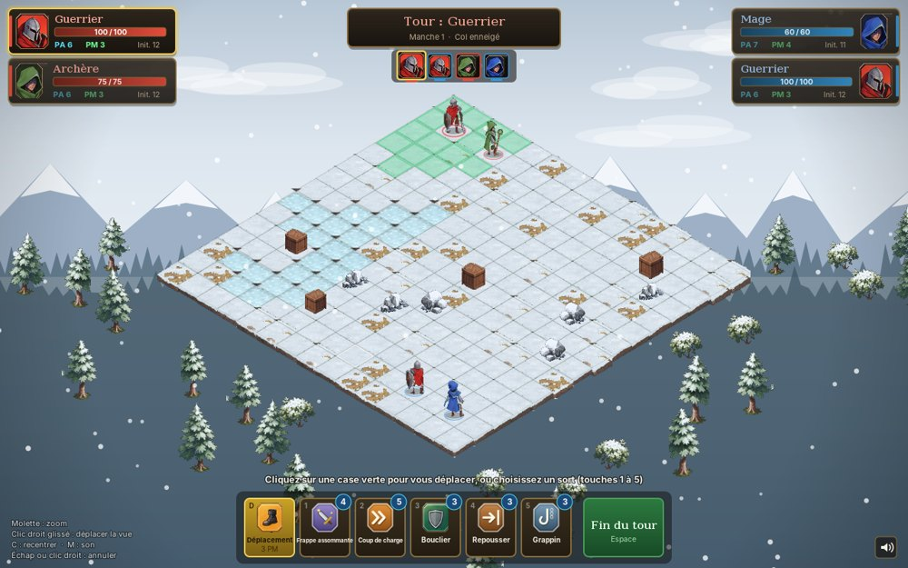
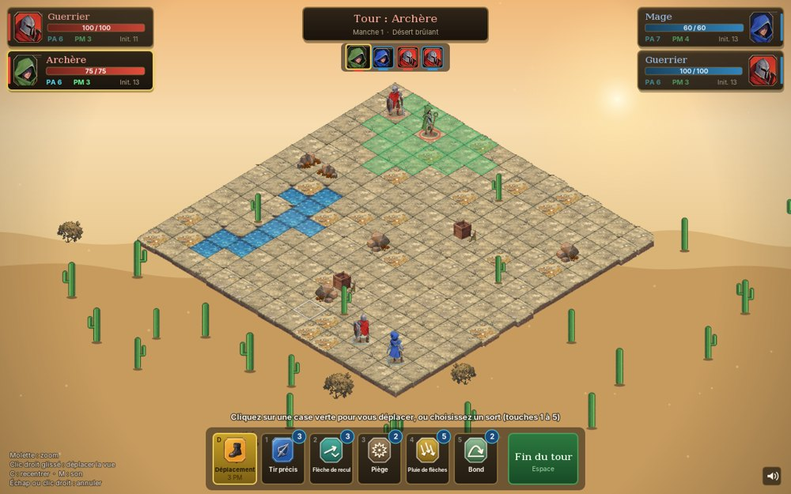
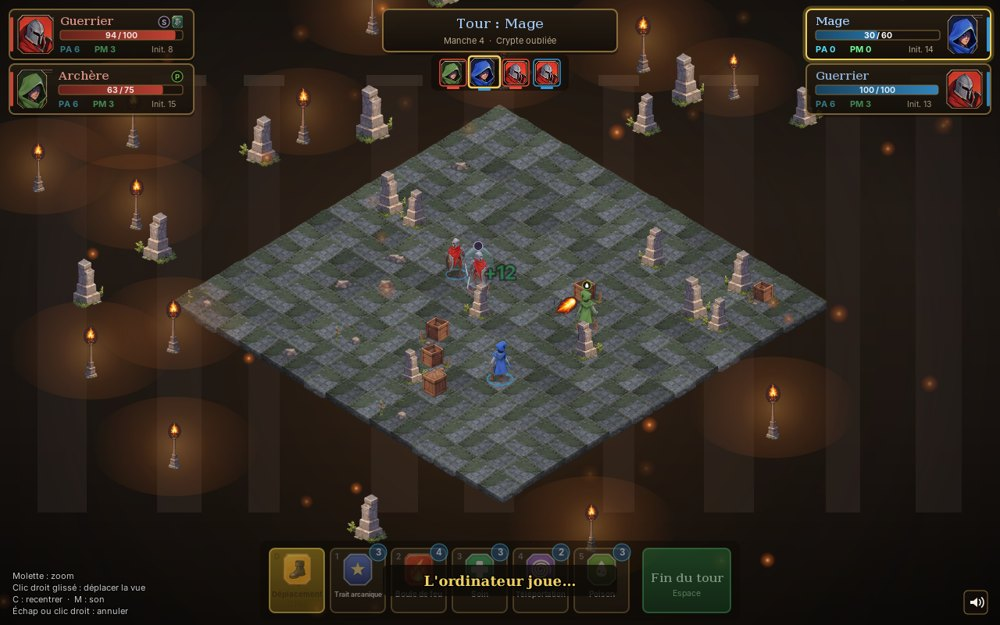
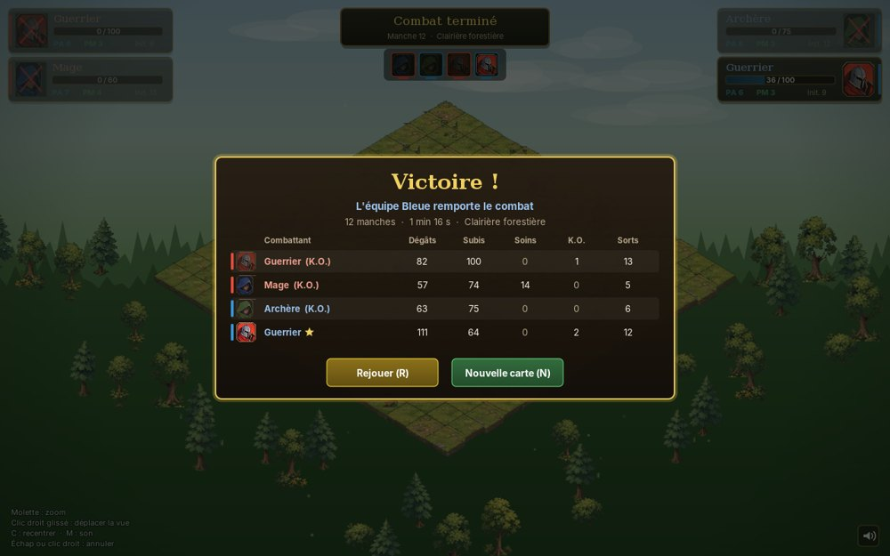

# Spells & Swords — combat tactique isométrique

Combat au tour par tour en équipes de 1 à 3 (Guerrier, Mage, Archère, Druide), sur une arène isométrique
générée aléatoirement, à deux joueurs sur le même PC ou contre l'ordinateur (3 niveaux).
Application de bureau en **Java 17+ (Swing / Java2D)**, sans aucune dépendance externe : le JDK
fournit le rendu, le son, et même la création d'un exécutable autonome.



| Préparer le combat | Ligne de vue (3 contre 3) | Transition de tour |
|---|---|---|
|  |  |  |
| **Col enneigé** | **Désert brûlant** | **Crypte oubliée** |
|  |  |  |



## Lancer le jeu

**Pour jouer tout de suite** : un JAR déjà compilé est fourni à la racine. Avec Java 17+ installé,
double-cliquez sur `SpellsAndSwords.jar` ou lancez `java -jar SpellsAndSwords.jar`.

Pour compiler : un **JDK 17 ou plus récent** (par exemple [Temurin 21](https://adoptium.net)).

| | Windows | Linux / macOS |
|---|---|---|
| Compiler, tester, créer le JAR | `build.bat` | `./build.sh` |
| … puis jouer | `build.bat run` | `./build.sh run` |
| Application autonome (Java embarqué, ~85 Mo) | `build.bat package` → `build\dist\SpellsAndSwords\SpellsAndSwords.exe` | `./build.sh package` |

Le jeu s'ouvre sur l'**écran titre** : choisissez « Contre l'ordinateur », « Jouer en ligne » ou
« Deux joueurs », puis composez les équipes et la carte. Pour tester plus vite, des options lancent directement un combat :

| Option | Effet |
|---|---|
| `--red warrior,archer` · `--blue mage,mage,warrior` | composition des équipes (1 à 3 parmi `warrior`, `mage`, `archer`, `druid`) |
| `--ai easy\|normal\|hard` · `--ai-red …` | l'ordinateur joue l'équipe bleue (ou rouge) |
| `--map forest\|ruins\|mountain\|desert\|arena` · `--seed 1234` | carte, et graine pour rejouer exactement la même |

Exemple : `java -jar build/SpellsAndSwords.jar --red warrior,archer --blue mage,warrior --ai hard`.

Pour travailler dans un IDE (IntelliJ IDEA, Eclipse, VS Code), ouvrez simplement le dossier :
le `pom.xml` décrit le projet (structure Maven standard). Classe principale : `com.minidofus.Main`.

## Jouer en ligne

Jusqu'à 6 joueurs (3 contre 3) dans un salon : chacun prend une place et une classe, les places libres sont
jouées par l'ordinateur. Chrono par tour (30, 60 ou 90 s), chat (`Entrée` en combat) et reconnexion
automatique en cas de coupure.

- **Serveur permanent (VPS)** : `java -jar SpellsAndSwords.jar --server [--port 7777] [--password secret]`, ou
  le script `deploy/install-server.sh`, qui l'installe comme service. Guide pas à pas pour un VPS IONOS :
  [docs/SERVEUR.md](docs/SERVEUR.md).
- **Sans serveur** : « Jouer en ligne » → « Héberger sur ce PC » (réseau local, ou port 7777 ouvert sur la box).

Tous les joueurs doivent avoir la même version du jeu.

## Commandes

| Action | Souris | Clavier |
|---|---|---|
| Se déplacer | clic sur une case verte (le chemin et son coût s'affichent au survol) | `D` : mode déplacement |
| Choisir un sort | clic sur le bouton (info-bulle au survol) | `1` à `5` |
| Lancer le bouclier | clic sur son personnage ou second clic sur le bouton | même touche une seconde fois |
| Annuler le sort sélectionné | clic droit, ou clic hors des cases valides | `Échap` |
| Fin du tour | bouton vert | `Espace` ou `Entrée` |
| Caméra | molette : zoom · clic droit glissé : déplacement | `C` : recentrer |
| Pause (reprendre, recommencer, menu) | — | `Échap` sans sort sélectionné |
| Divers | icône haut-parleur | `M` : son · `F3` : images/s · `R` / `N` / `Échap` en fin de partie |

## Règles

Chaque combattant a des **PA** (points d'action, pour les sorts) et des **PM** (points de mouvement),
rendus au début de son tour. L'**ordre de jeu** est fixé au début du combat : chaque équipe est
triée par initiative (base de la classe + tirage), puis les équipes jouent en alternance. La frise sous
le bandeau de tour montre cet ordre.

- **Ligne de vue** : les sorts à distance exigent de voir la case visée. Rochers, caisses et
  combattants bloquent la vue, l'eau non. Les cases à portée mais masquées s'affichent en gris.
- **Obstacles destructibles** : les caisses (24 PV) et rondins (18 PV) se détruisent à coups de sorts
  ou de chocs ; la case devient alors praticable. Les rochers sont indestructibles.
- **Poussée** : un combattant poussé contre un obstacle, un bord ou un autre combattant subit 6 dégâts
  par case non parcourue (le combattant percuté en subit la moitié).
- **Statuts** : poison (dégâts au début de chaque tour), silence (plus de sorts pendant un tour, puis
  immunité un tour), bouclier (-50 % de dégâts jusqu'au prochain tour).
- **Relance** : certains sorts ne sont relançables qu'au bout de N tours (indiqué sur le bouton).
- **Tir allié** : les sorts de zone touchent aussi vos alliés (jamais le lanceur).

| Classe | PV / PA / PM | Sorts |
|---|---|---|
| **Guerrier** (contrôle, corps à corps) | 100 / 6 / 3 | Frappe assommante (silence) · Coup de charge · Bouclier · Repousser · Grappin |
| **Mage** (distance, contrôle) | 60 / 7 / 4 | Trait arcanique · Boule de feu (croix) · Zone de glace (3×3, sol gelé 2 tours : dégâts et -2 PM) · Téléportation · Bouclier de pierre (bloque la prochaine attaque) |
| **Archère** (longue portée, terrain) | 75 / 6 / 3 | Tir précis · Flèche de recul · Piège · Pluie de flèches (3×3) · Bond |
| **Druide** (soutien, contrôle de zone) | 80 / 6 / 3 | Lancer de corbeau · Nuée d'abeilles (6 dégâts sur 3 tours) · Tornade (3×3, éjecte hors de la zone) · Éclair (sans ligne de vue) · Aqua vita (soin) |

Les valeurs exactes (dégâts, portées, relances) sont dans l'info-bulle de chaque sort et dans
`model/catalog/FighterCatalog.java`.

**Ordinateur** : il essaie chaque action possible sur une copie du combat (tirages remplacés par leur
moyenne) et garde celle qui mène à la meilleure situation. *Facile* choisit souvent un coup correct
sans être le meilleur ; *Normal* joue le meilleur coup et se place selon sa classe ; *Difficile*
anticipe aussi la riposte adverse.

## Cartes

| Carte | Biome | Particularité |
|---|---|---|
| Clairière forestière | prairie | plateau en forêt, rochers et rondins, feuillage au premier plan |
| Ruines oubliées | crépuscule | dallage muré au soleil couchant, gravats, tombes, colonnes, cendres et braises |
| Sommet enneigé | neige | plateau de roche au-dessus des cascades gelées, cristaux, congères, sapins, flocons |
| Désert brûlant | désert | plateau rocheux sous un ciel animé, rochers et cactus (destructibles), poussière |
| Arène impériale | désert | sable du Colisée devant la foule (murmure, clameurs), colonnes, statues, amphores et bannières |

Chaque carte a son ambiance sonore en boucle (coupée avec `M`).

## Architecture

```
src/main/java/com/minidofus/
├── Main.java                 point d'entrée (fenêtre, options de lancement)
├── model/                    RÈGLES DU JEU — aucune dépendance graphique, testable seule
│   ├── Battle.java           initiative, tours, déplacements, sorts, statuts, pièges, victoire ; publie des BattleEvent
│   ├── BattleEvent.java      ce qui s'est passé (déplacé, touché, soigné…), rejoué par la vue
│   ├── Board, Cell, Terrain  grille 15×15 stockée en tableaux (pas de clés texte "x,y")
│   ├── Fighter(Class)        combattant (état) et sa classe (caractéristiques, sorts)
│   ├── Pathfinder.java       parcours en largeur sur tableaux d'entiers
│   ├── Spell, SpellContext   contrat d'un sort et ce qu'il a le droit de faire
│   ├── LineOfSight.java      ligne de vue (cases traversées, règle permissive aux coins)
│   ├── spell/                un fichier par mécanique : frappe, zone, charge, grappin, poison, piège, mobilité…
│   ├── ai/                   ordinateur : simulation de chaque action et évaluation, 3 niveaux
│   ├── catalog/              FighterCatalog : tout l'équilibrage au même endroit
│   └── map/                  génération de cartes (ambiances, décor, garanties de jouabilité)
├── engine/                   images (cache, miroirs, teintes), sons (clips préchargés), courbes
├── view/                     rendu : projection iso, caméra, scène, personnages
│   ├── anim/                 petites animations composables (séquence, parallèle, interpolation)
│   └── fx/                   effets : projectiles, explosions, entailles, chiffres flottants
├── net/                      jeu en ligne : protocole texte, serveur (salon, chrono, IA, reconnexion), client
├── ui/                       HUD dessiné en Java2D : fiches, frise, barre d'actions, info-bulles, fin de partie
│   └── menu/                 écran titre (avec partie de démonstration en fond), configuration, boutons
└── game/                     assemblage : session de jeu, contrôleur de tour, présentateur, fenêtre (menus, combat, pause)
```

Le principe central : **le modèle applique les règles instantanément et publie des événements ; la vue
les rejoue ensuite avec ses animations.**

```
clic ─▶ TurnController ─▶ Battle (règles) ─▶ BattleEvent ─▶ BattlePresenter ─▶ file d'animations ─▶ rendu
```

Conséquences : les règles se testent sans écran, une animation ne peut pas désynchroniser l'état du
jeu, et ajouter une IA ou du réseau ne demande de toucher qu'au modèle.

**En ligne**, le serveur fait autorité : les joueurs envoient des intentions (`Command` : déplacer,
lancer, finir le tour), le serveur les valide et les diffuse numérotées. Chaque joueur les rejoue sur sa
propre copie du combat, créée avec la même graine, puis compare une empreinte de l'état. En cas d'écart,
le combat est rechargé automatiquement.

## Ce qui a changé par rapport au prototype HTML

**Corrections de règles**

- *Coup de charge* : le guerrier parcourait toujours la portée maximale, quelle que soit la case
  visée ; il s'arrête maintenant sur la case choisie. Une charge bloquée dès la première case
  consommait 5 PA pour rien ; elle est désormais refusée.
- *Bouclier* : annoncé pour 1 tour, il durait en réalité 2 tours adverses (`duration + 1`).
- *Eau* : purement décorative, elle était traversable. Elle est maintenant infranchissable, et la
  carte « Bord de lac » a un véritable étang.
- *Cartes* : rien ne garantissait qu'un chemin relie les deux combattants ni que les arbres ne masquent
  pas le terrain. La génération vérifie maintenant ces deux points (testé sur 900 cartes).
- Le flash rouge d'un coup effaçait la teinte bleue du bouclier : l'affichage du bouclier est
  désormais indépendant.

**Code et performance**

- Un fichier unique de 1 200 lignes → 58 fichiers (le plus long fait 440 lignes), en paquets aux responsabilités distinctes.
- Plus de `if (spell.id === 'boule_de_feu')` dispersés : chaque sort porte ses règles.
- Le sol (225 tuiles, quadrillage, fleurs) est peint **une seule fois** dans une image ; chaque image
  ne trie et ne dessine plus que quelques dizaines de sprites. 60 images/s mesurées en rendu
  logiciel sur un écran virtuel.
- Les surbrillances ne sont recalculées que si l'état, la sélection ou la case survolée change.
- Sons préchargés en mémoire (plusieurs voix par son) au lieu d'un nouvel objet audio par lecture.
- Plus besoin d'Internet : PixiJS et les polices venaient de CDN.
- Assets : 269 fichiers (~4 Mo, nombreux doublons) → 61 fichiers (1,8 Mo) nettoyés, voir ci-dessous.

**Ergonomie** : aperçu du chemin et de son coût en PM, aperçu de la zone d'impact, info-bulles des
sorts, raccourcis clavier, barre de vie animée, rejouer la même carte ou en tirer une nouvelle sans recharger.

**Présentation** : le pack ne fournit que des poses fixes, toutes les animations sont donc
procédurales (respiration au repos, balancement de marche, aura et étincelles d'incantation, recul
quand on est touché, chute puis âme qui s'élève à la mort). À chaque tour, la caméra glisse vers le
combattant actif s'il sort du cadre, une bannière à son portrait l'annonce et la frise d'initiative
avance. L'écran de fin récapitule les statistiques de chaque combattant (dégâts infligés et subis,
soins, éliminations, sorts lancés) et désigne le meilleur combattant.

## Personnaliser

- **Équilibrage** (PV, PA, PM, coûts, portées, dégâts) : `model/catalog/FighterCatalog.java`.
- **Cartes** (nombre d'obstacles, d'arbres, de fleurs, particularités) : `model/map/MapTheme.java`.
- **Orientation des personnages** : `src/main/resources/poses.properties`, sans recompiler la logique.
  Le pack ne fournit que 7 poses fixes, l'association pose ↔ direction est donc un choix ajustable.
- **Nouveau sort** : une classe dans `model/spell/` (étendre `AbstractSpell`), l'ajouter au catalogue,
  puis choisir sa mise en scène via `CastStyle` dans `game/BattlePresenter.java` et son icône dans
  `ui/Icons.java`.
- **Assets** : `tools/build_assets.py` régénère `src/main/resources/` depuis le dossier `assets/`
  d'origine (tri, suppression des pixels parasites du découpage, normalisation des tuiles,
  conversion OGG → WAV car Java ne lit pas l'OGG). Il fabrique aussi ce que le pack ne contient pas :
  sols de neige, de sable et de crypte (recoloration des tuiles d'herbe et de pierre), sapins enneigés,
  cactus dessinés, Archère (recoloration du Mage). Nécessite Python 3 (Pillow, numpy, scipy) et ffmpeg.
- **Illustrations fournies** : `tools/import_sources.py` importe les fichiers de `tools/source/` :
  la planche de l'Archère (détourage, choix des poses de repos et de marche, alignement des pieds,
  portrait) et le fond de la forêt (rochers peints effacés dans l'aire de jeu, bords prolongés, calage de
  la grille dans `backdrops/forest.properties`), et la planche du désert : damier peint retiré, pointe du
  plateau reconstruite (falaises prolongées puis fondues dans la brume), ciel animé (GIF) placé derrière
  les montagnes, rochers, cactus, buissons et fleurs détourés. Une illustration JPEG peut avoir sa
  transparence dans un masque `<nom>.alpha.png`, et un ciel animé (`sky`, `skyFrames`, `skyBottom` dans le
  fichier `.properties`). Pour une nouvelle carte illustrée : ajouter l'image, relever les 4 coins du
  plateau peint (fond, droite, avant, gauche), l'importer de la même façon et indiquer son nom dans
  `MapTheme`.
- **Ruines, Montagne, Arène** : `tools/import_maps.py` importe leurs planches (fond, coins du plateau, éléments
  détourés du damier, ombres, premier plan) ; foule de l'Arène synthétisée par `tools/arena_sounds.py`.
- **Interface** : `tools/import_ui.py` importe les portraits haute définition (visage recadré pour les fiches,
  illustration entière dans l'info-bulle de l'écran de préparation) et les boutons de pierre (étirés sans
  déformer leurs extrémités).
- **Druide** : poses tirées de `tools/source/druid_sheet.jpg`, effets de ses sorts des planches `fx_*`
  (corbeau, abeilles, tornade, éclair, potion), bruitages synthétisés par `tools/druid_sounds.py`.
- **Personnages** : Guerrier et Mage viennent de `tools/source/warrior_mage_sheet.png`, l'Archère de
  `archer_sheet.png` (poses de repos et de marche vers le sud-est et le nord-est, miroirs pour les deux
  autres directions ; choix des vignettes dans `SHEET_POSES` / `ARCHER_POSES`, réglages dans
  `poses.properties`).
- **Ombres et premier plan** : dans le `.properties` d'une carte illustrée, `shadow = dx, dy, opacité`
  couche les ombres portées à l'opposé du soleil de l'illustration ; `foreground = <nom>` ajoute des
  éléments flous dans les coins bas (`<nom>_left.png`, `<nom>_right.png`), avec `foreground.sway` (balancement)
  et `foreground.dust` (voile de poussière).
- **Perspective des cartes illustrées** : la grille n'y est pas un losange régulier mais une perspective
  (homographie, `view/Projection`) calée sur les coins du plateau peint (`grid.top`, `grid.right`,
  `grid.bottom`, `grid.left` dans le `.properties`). Elle épouse ainsi les bords de l'illustration ; les
  personnages et le décor sont un peu réduits au fond. Les cartes en tuiles gardent l'isométrie régulière.
- **Ambiances sonores** : `tools/ambience.py` les synthétise (bruit filtré et oscillateurs, boucles de
  16 s sans couture). Aucun fichier extérieur ; modifiez le script pour changer le caractère d'une carte.

## Tests

`build.sh` / `build.bat` lancent `AllTests` : 189 vérifications sur les règles (ligne de vue, initiative,
statuts, relances, poussées et chocs, pièges, caisses, victoire par équipe), sur la génération de 900 cartes,
sur l'ordinateur (parties complètes de 1c1 à 3c3, et le niveau Difficile doit battre le Facile), et sur
le jeu en ligne (déterminisme des commandes, protocole, mot de passe, salon, combat complet entre clients,
chrono, déconnexion, reconnexion, tentative de jouer à la place d'un autre).

Des outils de vérification visuelle, dans `src/test/java` :

- `game.Snapshots` joue une partie ordinateur contre ordinateur hors écran et enregistre une capture à
  la première apparition de chaque sort, avec le temps de rendu moyen.
- `WindowSmokeTest` ouvre la vraie fenêtre et la pilote avec de vrais clics et touches.
- `model.BalanceSim` fait jouer l'ordinateur (Difficile contre Difficile) dans toutes les confrontations de
  classes, en 1 contre 1 et en 2 contre 2, sur les 5 cartes, et affiche les taux de victoire :
  `java -cp build/classes:build/test com.minidofus.model.BalanceSim 30`.
- `OnlineSmokeTest` joue une partie en ligne dans la vraie fenêtre contre un joueur automatique : connexion,
  salon, chat, combat.
- `MenuSmokeTest` parcourt les menus dans la vraie fenêtre : titre, configuration, combat, pause, retour.

## Pistes

- Des animations de marche : le pack ne contient que des poses fixes.
- Si le projet grandit (plusieurs combats, monde ouvert, effets lourds), un moteur dédié comme
  libGDX (Java) ou Godot (C#) prendrait le relais ; le paquet `model/` se réutiliserait tel quel.
