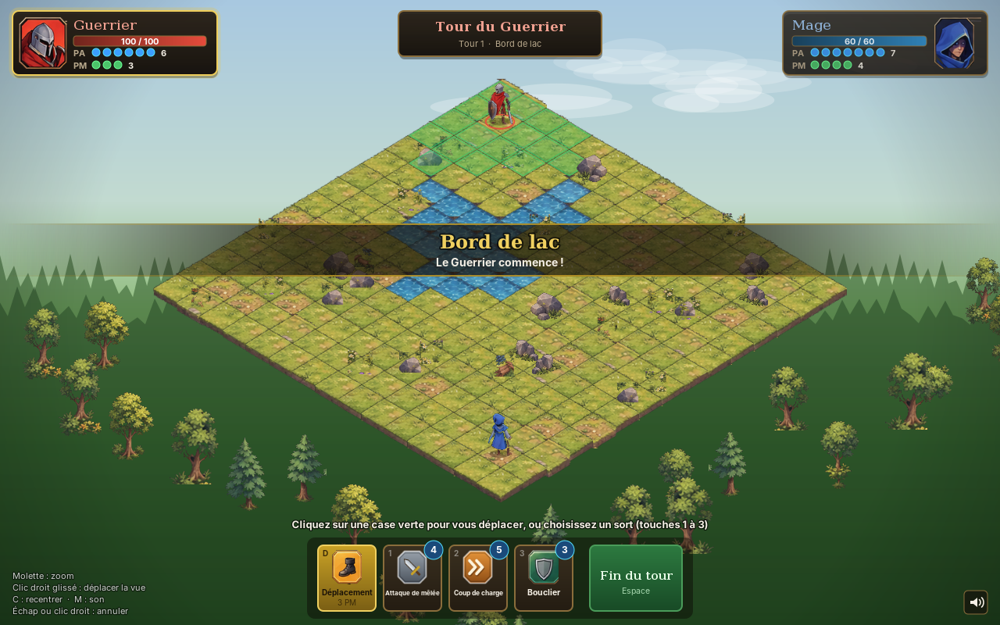
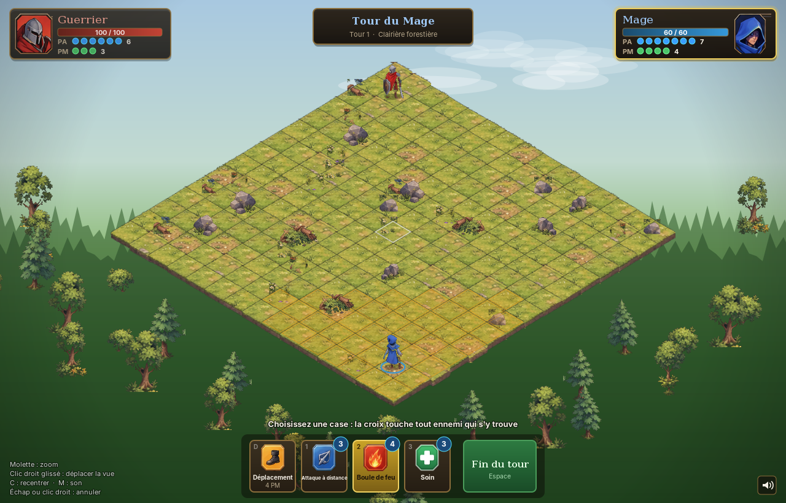
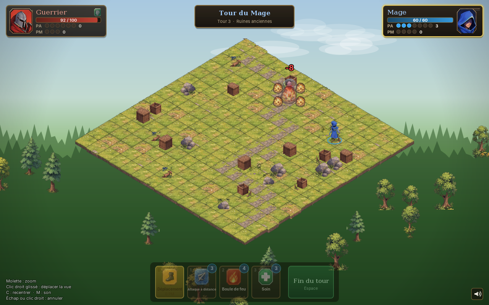
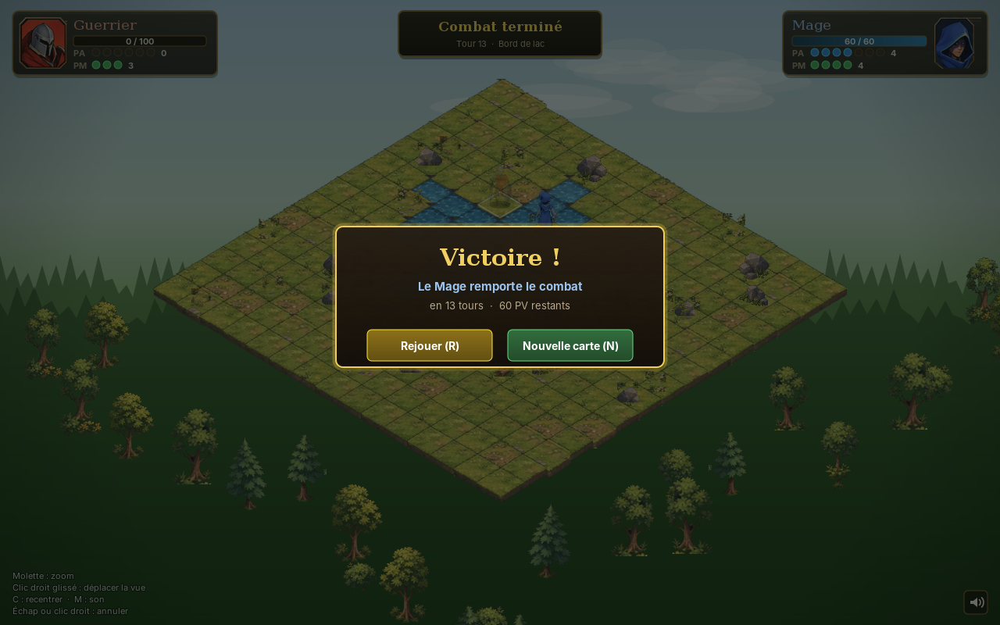

# Mini Dofus — combat tactique isométrique

Duel au tour par tour Guerrier contre Mage, sur une arène isométrique générée aléatoirement.
Application de bureau en **Java 17+ (Swing / Java2D)**, sans aucune dépendance externe : le JDK
fournit le rendu, le son, et même la création d'un exécutable autonome.



| Portée d'un sort | Boule de feu | Fin de combat |
|---|---|---|
|  |  |  |

## Lancer le jeu

**Pour jouer tout de suite** : un JAR déjà compilé est fourni à la racine. Avec Java 17+ installé,
double-cliquez sur `mini-dofus.jar` ou lancez `java -jar mini-dofus.jar`.

Pour compiler : un **JDK 17 ou plus récent** (par exemple [Temurin 21](https://adoptium.net)).

| | Windows | Linux / macOS |
|---|---|---|
| Compiler, tester, créer le JAR | `build.bat` | `./build.sh` |
| … puis jouer | `build.bat run` | `./build.sh run` |
| Application autonome (Java embarqué, ~85 Mo) | `build.bat package` → `build\dist\MiniDofus\MiniDofus.exe` | `./build.sh package` |

Le JAR seul se lance avec `java -jar build/mini-dofus.jar`. Options : `--map forest|ruins|lake` et
`--seed 1234` pour rejouer exactement la même carte.

Pour travailler dans un IDE (IntelliJ IDEA, Eclipse, VS Code), ouvrez simplement le dossier :
le `pom.xml` décrit le projet (structure Maven standard). Classe principale : `com.minidofus.Main`.

## Commandes

| Action | Souris | Clavier |
|---|---|---|
| Se déplacer | clic sur une case verte (le chemin et son coût s'affichent au survol) | `D` : mode déplacement |
| Choisir un sort | clic sur le bouton | `1`, `2`, `3` |
| Lancer un sort personnel (bouclier, soin) | clic sur son personnage ou second clic sur le bouton | même touche une seconde fois |
| Annuler le sort sélectionné | clic droit, ou clic hors des cases valides | `Échap` |
| Fin du tour | bouton vert | `Espace` ou `Entrée` |
| Caméra | molette : zoom · clic droit glissé : déplacement | `C` : recentrer |
| Divers | icône haut-parleur | `M` : son · `F3` : images/s · `R` / `N` en fin de partie |

## Architecture

```
src/main/java/com/minidofus/
├── Main.java                 point d'entrée (fenêtre, options --map / --seed)
├── model/                    RÈGLES DU JEU — aucune dépendance graphique, testable seule
│   ├── Battle.java           tours, déplacements, lancer de sorts, victoire ; publie des BattleEvent
│   ├── BattleEvent.java      ce qui s'est passé (déplacé, touché, soigné…), rejoué par la vue
│   ├── Board, Cell, Terrain  grille 15×15 stockée en tableaux (pas de clés texte "x,y")
│   ├── Fighter(Class)        combattant (état) et sa classe (caractéristiques, sorts)
│   ├── Pathfinder.java       parcours en largeur sur tableaux d'entiers
│   ├── Spell, SpellContext   contrat d'un sort et ce qu'il a le droit de faire
│   ├── spell/                un fichier par mécanique : frappe, zone en croix, charge, bouclier, soin
│   ├── catalog/              FighterCatalog : tout l'équilibrage au même endroit
│   └── map/                  génération de cartes (ambiances, décor, garanties de jouabilité)
├── engine/                   images (cache, miroirs, teintes), sons (clips préchargés), courbes
├── view/                     rendu : projection iso, caméra, scène, personnages
│   ├── anim/                 petites animations composables (séquence, parallèle, interpolation)
│   └── fx/                   effets : projectiles, explosions, entailles, chiffres flottants
├── ui/                       HUD dessiné en Java2D : fiches, barre d'actions, info-bulles, fin de partie
└── game/                     assemblage : session de jeu, contrôleur de tour, présentateur, fenêtre
```

Le principe central : **le modèle applique les règles instantanément et publie des événements ; la vue
les rejoue ensuite avec ses animations.**

```
clic ─▶ TurnController ─▶ Battle (règles) ─▶ BattleEvent ─▶ BattlePresenter ─▶ file d'animations ─▶ rendu
```

Conséquences : les règles se testent sans écran, une animation ne peut pas désynchroniser l'état du
jeu, et ajouter une IA ou du réseau ne demande de toucher qu'au modèle.

## Ce qui a changé par rapport au prototype HTML

**Corrections de règles**

- *Coup de charge* : le guerrier parcourait toujours la portée maximale, quelle que soit la case
  visée ; il s'arrête maintenant sur la case choisie. Une charge bloquée dès la première case
  consommait 5 PA pour rien ; elle est désormais refusée.
- *Bouclier* : annoncé pour 1 tour, il durait en réalité 2 tours adverses (`duration + 1`).
- *Eau* : purement décorative, elle était traversable. Elle est maintenant infranchissable, et la
  carte « Bord de lac » a un véritable étang.
- *Cartes* : rien ne garantissait qu'un chemin relie les deux combattants ni que les arbres ne masquent
  pas le terrain. La génération vérifie maintenant ces deux points (testé sur 900 cartes).
- Le flash rouge d'un coup effaçait la teinte bleue du bouclier : l'affichage du bouclier est
  désormais indépendant.

**Code et performance**

- Un fichier unique de 1 200 lignes → 58 fichiers (le plus long fait 440 lignes), en paquets aux responsabilités distinctes.
- Plus de `if (spell.id === 'boule_de_feu')` dispersés : chaque sort porte ses règles.
- Le sol (225 tuiles, quadrillage, fleurs) est peint **une seule fois** dans une image ; chaque image
  ne trie et ne dessine plus que quelques dizaines de sprites. 60 images/s mesurées en rendu
  logiciel sur un écran virtuel.
- Les surbrillances ne sont recalculées que si l'état, la sélection ou la case survolée change.
- Sons préchargés en mémoire (plusieurs voix par son) au lieu d'un nouvel objet audio par lecture.
- Plus besoin d'Internet : PixiJS et les polices venaient de CDN.
- Assets : 269 fichiers (~4 Mo, nombreux doublons) → 61 fichiers (1,8 Mo) nettoyés, voir ci-dessous.

**Ergonomie** : aperçu du chemin et de son coût en PM, aperçu de la zone d'impact, info-bulles des
sorts, raccourcis clavier, PA/PM en pastilles, barre de vie animée, rejouer la même carte ou en tirer
une nouvelle sans recharger.

## Personnaliser

- **Équilibrage** (PV, PA, PM, coûts, portées, dégâts) : `model/catalog/FighterCatalog.java`.
- **Cartes** (nombre d'obstacles, d'arbres, de fleurs, particularités) : `model/map/MapTheme.java`.
- **Orientation des personnages** : `src/main/resources/poses.properties`, sans recompiler la logique.
  Le pack ne fournit que 7 poses fixes, l'association pose ↔ direction est donc un choix ajustable.
- **Nouveau sort** : une classe dans `model/spell/` (étendre `AbstractSpell`), l'ajouter au catalogue,
  puis choisir sa mise en scène via `CastStyle` dans `game/BattlePresenter.java` et son icône dans
  `ui/Icons.java`.
- **Assets** : `tools/build_assets.py` régénère `src/main/resources/` depuis le dossier `assets/`
  d'origine (tri, suppression des pixels parasites du découpage, normalisation des tuiles,
  conversion OGG → WAV car Java ne lit pas l'OGG). Nécessite Python 3 (Pillow, numpy, scipy) et ffmpeg.

## Tests

`build.sh` / `build.bat` lancent `AllTests` : 86 vérifications sur les règles (déplacements, PA, charge,
zone, bouclier, soin, victoire) et sur la génération de 900 cartes.

Deux outils de vérification visuelle, dans `src/test/java` :

- `game.Snapshots` joue une partie automatique hors écran (une IA simple contrôle les deux camps)
  et enregistre des captures aux moments clés, avec le temps de rendu moyen.
- `WindowSmokeTest` ouvre la vraie fenêtre et la pilote avec de vrais clics et touches.

## Pistes

- Un adversaire contrôlé par l'ordinateur : l'IA de `Snapshots` est un bon point de départ, à déplacer
  dans le modèle.
- Des animations de marche : le pack ne contient que des poses fixes.
- Si le projet grandit (plusieurs combats, monde ouvert, effets lourds), un moteur dédié comme
  libGDX (Java) ou Godot (C#) prendrait le relais ; le paquet `model/` se réutiliserait tel quel.
